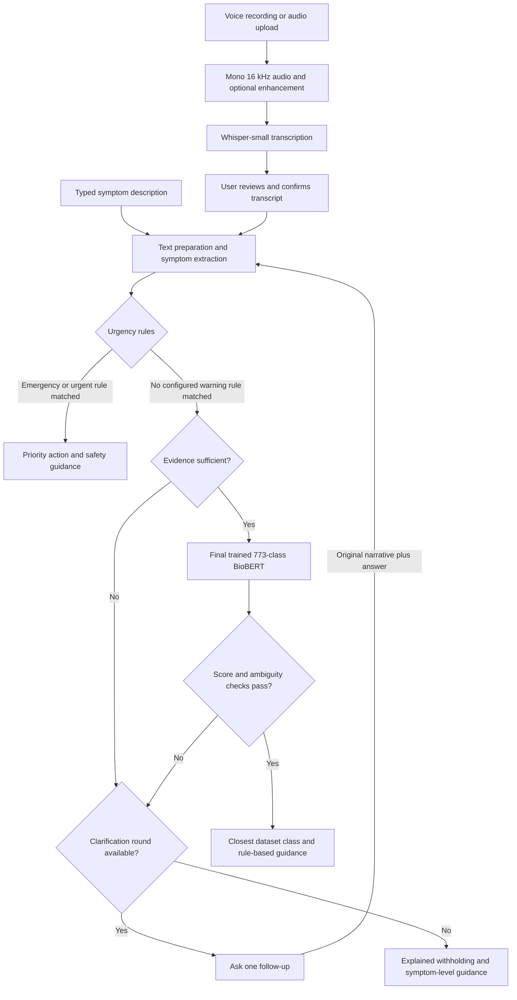

# MedVoice Assist

### Speech-enabled symptom understanding with comparative disease classification

A final-year thesis prototype combining **audio preprocessing**, **Whisper**, a
**trained BioBERT classifier**, and **rule-based guidance** in a React application.
The research compares TF-IDF + Logistic Regression, fine-tuned BERT and BioBERT
across two dataset settings, then integrates the selected classifier into an
inspectable voice-and-text workflow.

> **Research use only.** This prototype does not diagnose disease, provide a
> clinically validated triage assessment, or replace a healthcare professional.

[Features](#features) | [Workflow](#workflow) | [Results](#research-results) |
[Quick Start](#quick-start) | [Experiments](docs/EXPERIMENTS.md) |
[Limitations](#limitations)

## Features

- **Voice and text input:** browser recording or audio upload, with typed input
  using the same downstream analysis stages.
- **Review before analysis:** optional audio enhancement and an editable Whisper
  transcript, so transcription mistakes can be corrected before classification.
- **Structured symptom evidence:** canonical symptom extraction separates current,
  negated, uncertain, historical and other-person mentions.
- **Safety-first ordering:** configured urgent and emergency rules take priority
  over a disease-class prediction.
- **Bounded clarification:** one natural-language follow-up retains the original
  context; unresolved cases receive an explained fallback.
- **Selective predictions:** the trained 773-class BioBERT result is withheld when
  evidence or score checks are insufficient.
- **Traceable responses:** deterministic, source-linked guidance rather than a
  free-form generative medical answer.
- **Research inspection:** extracted evidence, classifier rankings and stage
  timings are available in the Research details panel.

## Workflow



Audio enhancement applies DC-offset removal, silence trimming, stationary noise
reduction and peak normalisation. Typed input skips the audio stages. A routine
urgency state means **no configured warning rule matched**, not that a situation
has been established as medically safe.

The current prediction gates use at least two distinct current symptoms, a top
model score of `0.50` and a top-two score margin of `0.10`, alongside clarification
checks. These are prototype thresholds, not clinically validated cut-offs.

[Editable system architecture](docs/MedVoiceAssist_System_Architecture.drawio)
and [full architecture figure](docs/MedVoiceAssist_System_Architecture.png).

## Tech Stack

| Layer | Technologies | Role |
| --- | --- | --- |
| Interface | React 19, JavaScript, Vite 7, CSS, Lucide React | Conversation, voice controls, transcript review and research panels |
| API | Python, FastAPI, Pydantic, Uvicorn | Validation and pipeline orchestration |
| Inference | PyTorch, Hugging Face Transformers, safetensors | Whisper and the locally trained BioBERT checkpoint |
| Speech | Whisper-small, librosa, noisereduce, SoundFile, PyAV | Audio enhancement, decoding and transcription |
| Classifier experiments | scikit-learn, TF-IDF, Logistic Regression, BERT, BioBERT | Comparative single-label disease classification |
| Analysis | pandas, NumPy, Matplotlib | Reports, metrics and reproducible figures |
| Verification | Python unittest, FastAPI TestClient, ESLint, Vite build | Rule, API and frontend checks |

No external generative-response API key is required. Public Whisper weights are
downloaded on first use; disease classification uses the restored local model.

## Research Results


*Percentages are derived from the retained reports. The two settings have
different datasets and training procedures; their scores are not a controlled
measurement of the effect of dataset size alone.*

### Expanded Dataset

| Classifier | Accuracy (%) | Weighted F1 (%) | Macro F1 (%) |
| --- | ---: | ---: | ---: |
| TF-IDF + Logistic Regression | 87.10 | 87.10 | **74.74** |
| Fine-tuned BERT | 87.26 | 87.31 | 73.43 |
| BioBERT | **87.27** | **87.32** | 73.08 |

BioBERT is the integrated classifier because it narrowly leads accuracy and
weighted F1 on this supplied test split. TF-IDF + Logistic Regression has the
highest macro F1. BioBERT's accuracy lead over BERT is approximately **0.016
percentage points**, so these results do not establish universal superiority or
statistical significance.

**Evaluation qualification:** the expanded files contain repeated descriptions;
23,863 of 24,695 test rows share an exact stripped text-and-label pair with
training data. These are retained supplied-split results, not independently
validated generalisation estimates. Macro reports include the 773-class label
list although only 697 classes have test support. See the
[results and provenance notes](docs/RESULTS.md).

<details>
<summary>Preliminary 24-class experiment and dataset progression</summary>

| Classifier | Accuracy (%) | Weighted F1 (%) | Macro F1 (%) |
| --- | ---: | ---: | ---: |
| TF-IDF + Logistic Regression | **96.67** | **96.54** | **96.70** |
| Fine-tuned BERT | 87.92 | 87.25 | 86.94 |
| BioBERT | 88.75 | 88.01 | 87.57 |

| Setting | Records | Training / test | Overall classes |
| --- | ---: | ---: | ---: |
| Symptom2Disease, preliminary study | 1,200 | 960 / 240 | 24 |
| Expanded disease-diagnosis files | 493,890 | 469,195 / 24,695 | 773 |

The expanded rows must not be interpreted as 493,890 independent patients.
Source files, model-selection differences and the separate legacy speech pilot
are documented in [Experiments](docs/EXPERIMENTS.md).

</details>

## Quick Start

### 1. Clone and Restore the Model

```powershell
git clone https://github.com/sean8911/medvoice-assist.git
cd medvoice-assist
```

Sign in to an account with access to this private repository. Download
`biobert-final.zip` and its checksum from the
[trained-model release](https://github.com/sean8911/medvoice-assist/releases/tag/initial-commit),
verify the checksum and extract into:

```text
3 Models After Training/outputs/models/biobert/
```

The release restores the final 773-class model, not an unfine-tuned upstream
checkpoint. Cloning alone does not download the weights. Follow the exact
[restoration and installation steps](docs/SETUP.md) before starting the app.

### 2. Install and Start

Use Python **3.10 or 3.11**, Node.js **20.19+ or 22.12+**, pnpm and the audio
dependencies in [Setup](docs/SETUP.md). From the repository root:

```powershell
python -m venv .venv
.\.venv\Scripts\Activate.ps1
cd medical_chatbot_app
.\setup.ps1
.\start_app.ps1
```

Open **http://127.0.0.1:8000**. For later sessions, activate the same environment
and run `start_app.ps1`; installation and training are not required each time.
CPU inference is supported, but voice processing and model loading can be slow.

## Demo Walkthrough

Use fictional scenarios, not real patient information:

| Step | Try this | What to inspect |
| --- | --- | --- |
| Start a conversation | `I have a headache.` | Recognised evidence and one follow-up |
| Add details naturally | `I also feel nauseous, have vomited twice, and saw flashing lights before the headache. I do not have weakness, confusion, fainting, or slurred speech.` | Retained context, exclusions and actual classifier outcome |
| Inspect the result | Open **Research details** | Canonical BioBERT input, status, rankings and timings |
| Try voice input | Record a short fictional description | Enhancement toggle and editable transcript before confirmation |

A displayed class is not guaranteed, and a model score is not a calibrated
disease probability. [The screenshot guide](docs/SCREENSHOTS.md) lists the
interface views for genuine captures; no mock screenshots or edited predictions
are used as demonstration evidence.

## Reproduce and Verify

The repository retains the preliminary notebooks, expanded-dataset training
scripts and final reports. [Experiments](docs/EXPERIMENTS.md) distinguishes
historical settings from commands for new runs. No retraining was performed
during repository cleanup.

From the repository root:

```powershell
python -m unittest discover -s medical_chatbot_app/backend/tests -t . -v
python -m unittest discover -s voice_biobert_pipeline/tests -v
cd medical_chatbot_app/frontend
pnpm lint
pnpm build
```

API tests use controlled model doubles for orchestration. They do not measure
the real classifier's medical accuracy or validate clinical safety.

## Repository Map

| Path | Purpose |
| --- | --- |
| [medical_chatbot_app/](medical_chatbot_app/) | React/FastAPI application and API tests |
| [voice_biobert_pipeline/](voice_biobert_pipeline/) | Speech and symptom modules, rules, tests and speech-evaluation code |
| [TF-IDF and Fine Tune BERT/](TF-IDF%20and%20Fine%20Tune%20BERT/) | Expanded three-model training source |
| [BioBERT/](BioBERT/) | BioBERT-only continuation and comparison source |
| [3 Models After Training/outputs/](3%20Models%20After%20Training/outputs/) | Final reports, run metadata and lightweight model metadata |
| Root notebooks and comparison CSVs | Preliminary 24-class experiments |
| [docs/](docs/) | Thesis chapters, architecture, setup, results and visual assets |
| [scripts/](scripts/) | Retained notebook/figure utilities and README-asset generation |

Downloaded datasets, weights, environments, participant records and scratch
files are excluded from Git. Retired duplicates and authoring notes were removed
from the current repository view, not deleted from the development laptop.
[Repository scope](docs/GITHUB_CONTENTS.md) explains the retained material.

## Limitations

- Classification results are dataset- and split-specific, with substantial
  expanded-set overlap and differing historical validation procedures.
- The earlier six-recording speech pilot predates the latest integrated symptom
  and conversation controls; it is not a full current-pipeline benchmark.
- Extraction, negation, urgency and response rules have incomplete coverage and
  require qualified medical review. A high classifier score cannot validate them.
- Five-person usability evaluation is planned, not presented here as completed.
  Do not substitute generated reviews for participant observations.
- The research JSON export contains the analysis object, not a complete combined
  audio/transcription record. Its displayed total does not establish end-to-end
  voice latency.
- The prototype currently operates in English. No public deployment is provided.

## Documentation and Contact

- [Application and API details](medical_chatbot_app/README.md)
- [Speech-pipeline instructions](voice_biobert_pipeline/README.md)
- [Thesis proposal](AIT2309970_Thesis%20Proposal.pdf)
- [Chapter 3 methodology](docs/Thesis_Chapter_3_Sections_3_5_to_3_9.docx)
- [Chapter 4 implementation](docs/Chapter_4_Implementation_and_Experiments/Chapter_4_Implementation_and_Experiment.docx)
- [Chapter 4 LaTeX algorithms](docs/Chapter_4_Implementation_and_Experiments/Chapter_4_Algorithms.tex)

Maintained by [sean8911](https://github.com/sean8911). Use repository issues for
technical questions; do not post personal health information or credentials.
No project-wide licence has been selected. Dataset and pretrained-model terms
are separate and should be checked before redistribution.
