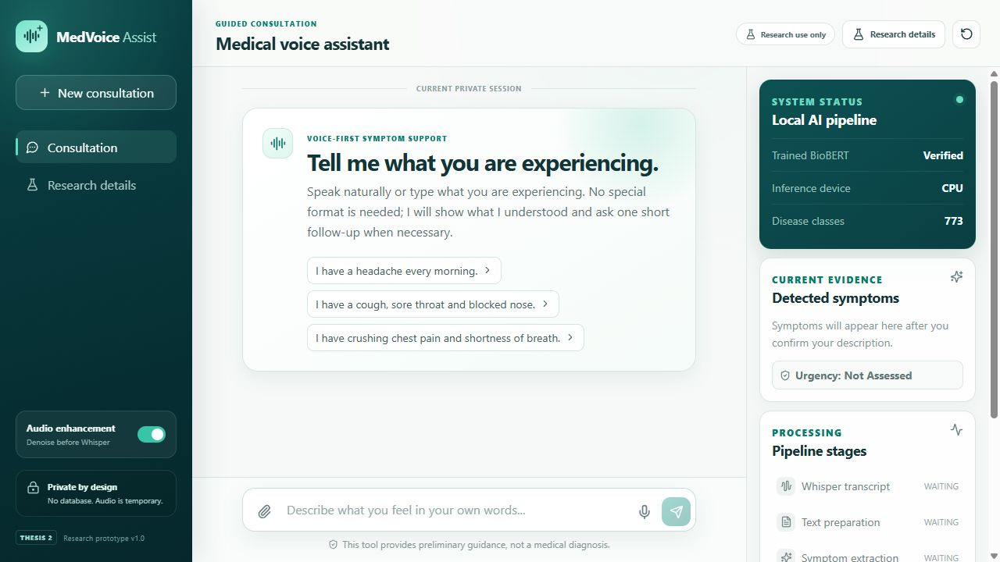
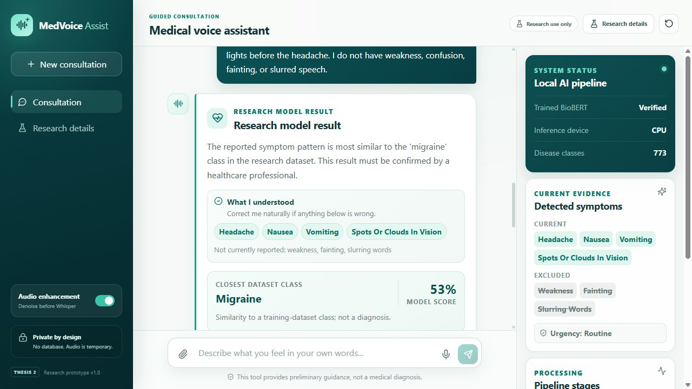
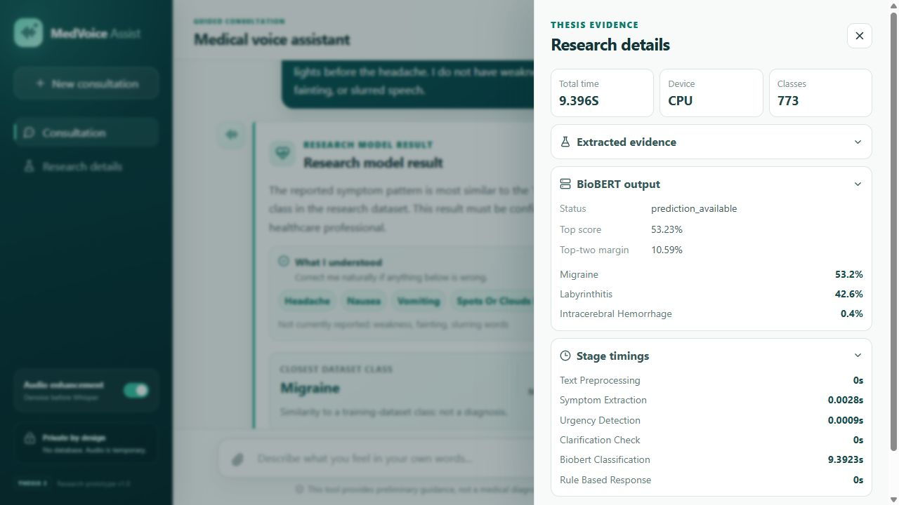
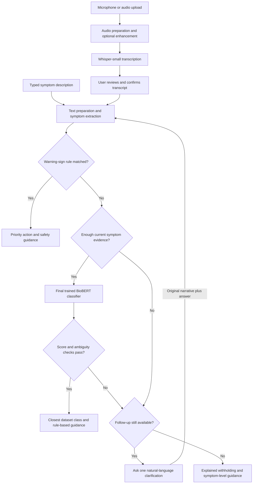
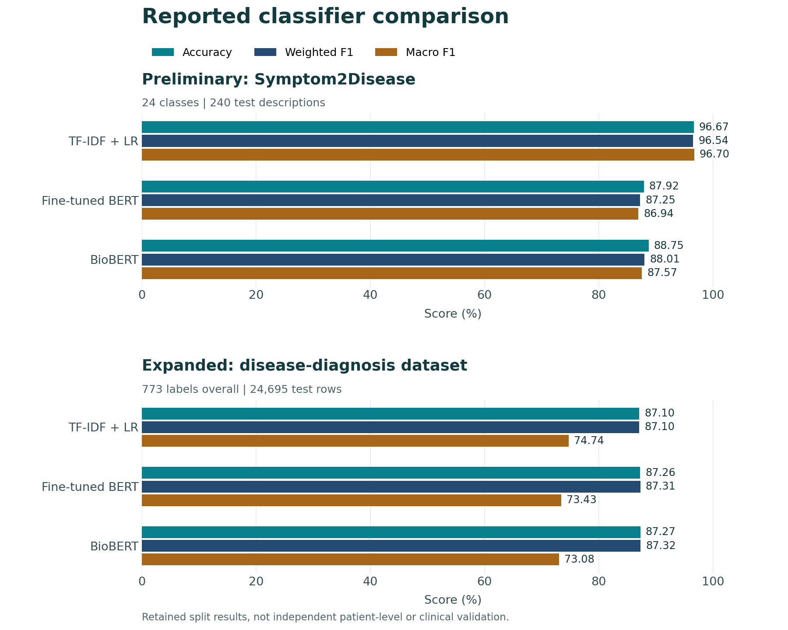

# MedVoice Assist

**A speech-enabled medical chatbot research prototype with an inspectable AI pipeline.**


MedVoice Assist combines audio preprocessing, Whisper transcription, structured
symptom extraction, a locally trained **773-class BioBERT classifier**, and
rule-based guidance in a React and FastAPI application. The accompanying research
compares **TF-IDF + Logistic Regression, fine-tuned BERT, and BioBERT** across
preliminary and expanded disease-classification datasets.

> **Research use only.** This software does not diagnose disease, provide
> clinically validated triage, or replace a qualified healthcare professional.

[Features](#features) | [Demo](#application-demo) | [Architecture](#architecture) |
[Results](#model-comparison) | [Setup](#getting-started) | [Documentation](#documentation)



## Features

| Capability | Implementation |
| --- | --- |
| Voice and text input | Browser microphone, audio upload, or a typed symptom description |
| Transcript review | Optional audio enhancement followed by an editable Whisper transcript |
| Symptom understanding | Canonical symptoms with current, negated, uncertain, historical and other-person evidence |
| Urgency screening | Configured warning-sign rules run before disease classification |
| Natural clarification | One bounded follow-up that preserves the original narrative |
| Selective classification | Evidence, score and ambiguity checks can withhold a disease-class result |
| Rule-based responses | Deterministic guidance with source links, without a generative-response API |
| Research inspection | Extracted evidence, ranked model outputs, stage timings and JSON export |

## Application Demo

The screenshots show the actual local application on **2 November 2026**, using
a **fictional, typed** headache scenario and a natural-language follow-up. They
are interface demonstrations, not participant records, clinical evidence, or a
benchmark of the complete voice pipeline.



<details>
<summary>Inspect the real model output and processing details</summary>



The displayed model score is not a calibrated probability of having a disease.
The application can ask for clarification or withhold a prediction; a displayed
class is not guaranteed for every input.

</details>

## Architecture



Audio enhancement includes DC-offset removal, silence trimming, stationary noise
reduction and peak normalisation. Typed input bypasses the audio stages. The
default prediction gates require two distinct current symptoms, a top model
score of `0.50`, and a top-two margin of `0.10`, alongside clarification checks.
These are prototype settings, not clinically validated thresholds. A routine
urgency state means **no configured warning rule matched**, not proven safety.

The [editable architecture diagram](docs/MedVoiceAssist_System_Architecture.drawio)
and [full architecture figure](docs/MedVoiceAssist_System_Architecture.png) provide
an alternative view of the system.

## Model Comparison

### Expanded Dataset

| Classifier | Accuracy (%) | Weighted F1 (%) | Macro F1 (%) |
| --- | ---: | ---: | ---: |
| TF-IDF + Logistic Regression | 87.10 | 87.10 | **74.74** |
| Fine-tuned BERT | 87.26 | 87.31 | 73.43 |
| BioBERT | **87.27** | **87.32** | 73.08 |

BioBERT is integrated into the prototype because it narrowly leads accuracy and
weighted F1 on the retained supplied split. TF-IDF + Logistic Regression leads
macro F1. The BioBERT/BERT accuracy gap is approximately **0.016 percentage
points**, not evidence of universal superiority or statistical significance.

**Evaluation caveat:** 23,863 of 24,695 test rows share an exact stripped
text-and-label pair with the training data. These are supplied-split results,
**not independent generalisation estimates**. Macro metrics use the full
773-label list, although only 697 labels have test support. See
[results and provenance](docs/RESULTS.md) before interpreting the scores.



The preliminary study used Symptom2Disease: 1,200 descriptions and 24 classes.
The expanded prepared files contain 493,890 rows and 773 labels. Different
datasets and historical training procedures mean the two experiments do not
isolate dataset size as a single controlled variable.
[Experiment details](docs/EXPERIMENTS.md) document both settings.

## Tech Stack

| Layer | Technologies |
| --- | --- |
| Frontend | React 19, JavaScript, Vite 7, CSS, Lucide React |
| Backend | Python, FastAPI, Pydantic, Uvicorn |
| Model inference | PyTorch, Hugging Face Transformers, safetensors, BioBERT |
| Speech processing | Whisper-small, librosa, noisereduce, SoundFile, PyAV |
| Classification experiments | scikit-learn, TF-IDF, Logistic Regression, BERT, BioBERT |
| Analysis and verification | pandas, NumPy, Matplotlib, unittest, FastAPI TestClient, ESLint |

## Getting Started

### Requirements

Use **Python 3.10 or 3.11**, **Node.js 20.19+ or 22.12+**, pnpm, and the audio
dependencies described in [Setup](docs/SETUP.md). Windows PowerShell launch
scripts are provided. CPU inference is supported but can be slow; a compatible
GPU is optional. No external generative-response API key is required.

### 1. Clone the Repository

```powershell
git clone https://github.com/sean8911/medvoice-assist.git
cd medvoice-assist
```

The repository is private; your GitHub account must have access.

### 2. Restore the Trained BioBERT Model

Download `biobert-final.zip` and `biobert-final.sha256` from the
[trained-model release](https://github.com/sean8911/medvoice-assist/releases/tag/initial-commit).
Follow the [checksum verification and extraction instructions](docs/SETUP.md#restore-the-final-trained-model)
to restore the model to:

```text
3 Models After Training/outputs/models/biobert/
```

Cloning alone does not download the weights. The release contains the final
trained 773-class checkpoint, not an unfine-tuned upstream BioBERT model.

### 3. Install and Start

From the repository root:

```powershell
python -m venv .venv
.\.venv\Scripts\Activate.ps1
cd medical_chatbot_app
.\setup.ps1
.\start_app.ps1
```

Open **http://127.0.0.1:8000**. Public Whisper weights are downloaded and cached on
first use. For later sessions, activate the same environment and run
`start_app.ps1`; reinstalling dependencies or retraining is not required.

The health endpoint is `/api/health`; interactive API documentation is at `/docs`.
For development mode and troubleshooting, see [Setup](docs/SETUP.md).

## Repository Structure

| Location | Purpose |
| --- | --- |
| [medical_chatbot_app/](medical_chatbot_app/) | React frontend, FastAPI backend, launch scripts and API tests |
| [voice_biobert_pipeline/](voice_biobert_pipeline/) | Speech processing, extraction, urgency, clarification, responses and tests |
| [TF-IDF and Fine Tune BERT/](TF-IDF%20and%20Fine%20Tune%20BERT/) | Expanded three-model training code and configuration |
| [BioBERT/](BioBERT/) | BioBERT continuation training and required baseline reports |
| [3 Models After Training/outputs/](3%20Models%20After%20Training/outputs/) | Canonical model reports, run metadata and lightweight inference metadata |
| Root notebooks and comparison reports | Preliminary experiments and their retained outputs |
| [docs/](docs/) | Setup, experiment methodology, result provenance, architecture and demo assets |
| [scripts/](scripts/) | Notebook, validation and report-figure utilities |

Thesis-writing drafts, rewrite figures, document-generation helpers, downloaded
datasets, full weights, caches and participant records are not part of the Git
source tree. [Repository scope](docs/GITHUB_CONTENTS.md) explains what is retained.

## Verification

Run from the repository root in an environment with the project dependencies:

```powershell
python -m unittest discover -s medical_chatbot_app/backend/tests -t . -v
python -m unittest discover -s voice_biobert_pipeline/tests -v
cd medical_chatbot_app/frontend
pnpm lint
pnpm build
```

API tests use controlled model doubles to test orchestration. They do not
measure clinical accuracy. Training commands and separate environment
requirements are documented in [Experiments](docs/EXPERIMENTS.md).

## Scope and Limitations

- The prototype currently operates in English and is intended for local research
  demonstrations, not public clinical deployment.
- Classification performance is dataset- and split-specific, with substantial
  overlap in the expanded training and test files.
- Extraction, negation, urgency and response rules have incomplete coverage and
  require qualified medical review. A high model score does not validate them.
- The retained six-recording speech pilot predates the latest conversation
  pipeline and is not a full benchmark of the current chatbot.
- Research-panel timings cover the recorded analysis stages, not necessarily
  complete microphone-to-response latency.
- No database is configured. Audio uploads are temporary; users should still
  avoid real patient information in demonstrations, issue reports and logs.

## Documentation

- [Installation and model restoration](docs/SETUP.md)
- [Application and API reference](medical_chatbot_app/README.md)
- [Speech pipeline and command-line usage](voice_biobert_pipeline/README.md)
- [Experiments and reproducibility](docs/EXPERIMENTS.md)
- [Results, provenance and evaluation qualifications](docs/RESULTS.md)
- [Repository contents and model release](docs/GITHUB_CONTENTS.md)

Maintained by [sean8911](https://github.com/sean8911). Use repository issues for
technical questions without posting health information, credentials or
participant data. No project-wide licence has been selected; datasets and
pretrained models retain their own terms.
